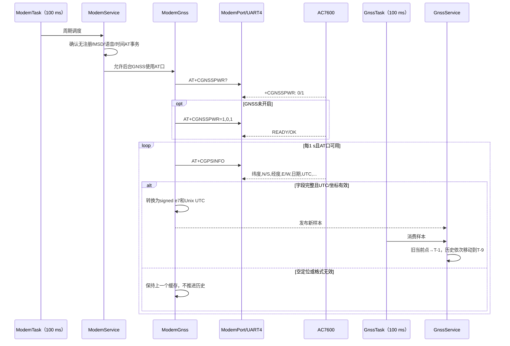
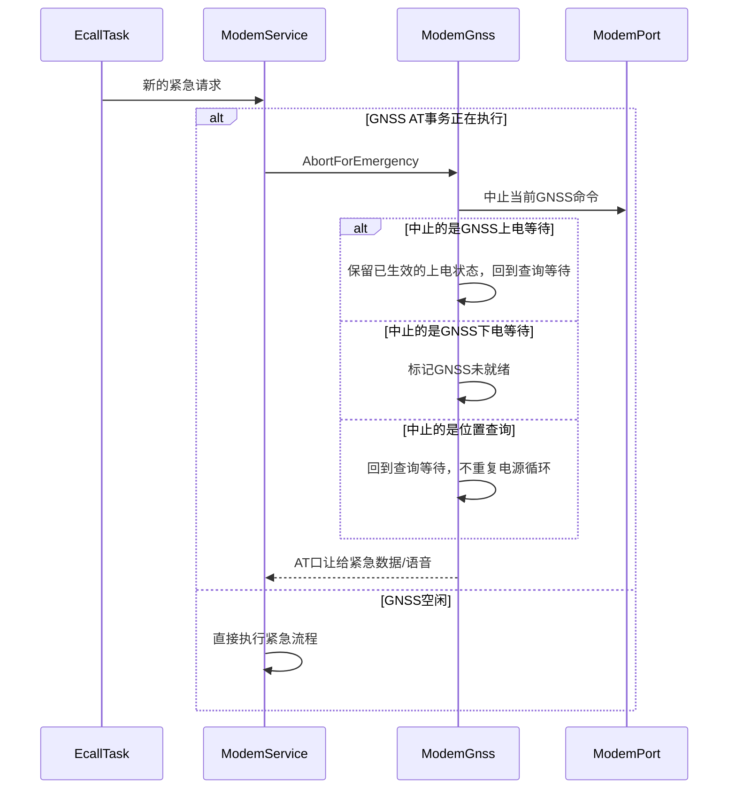
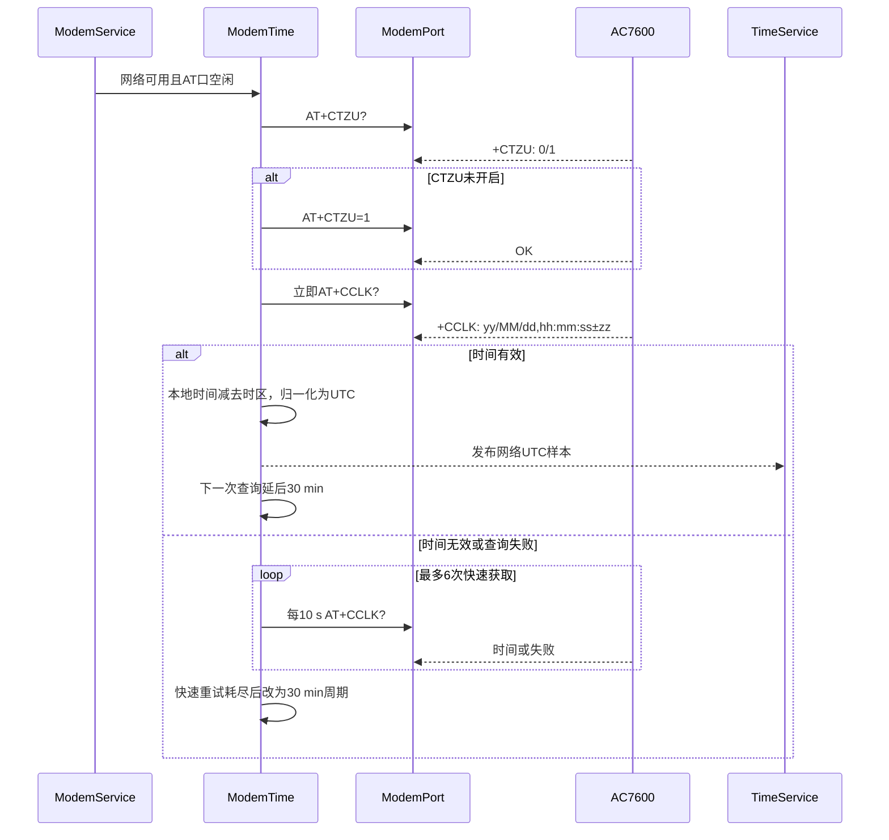
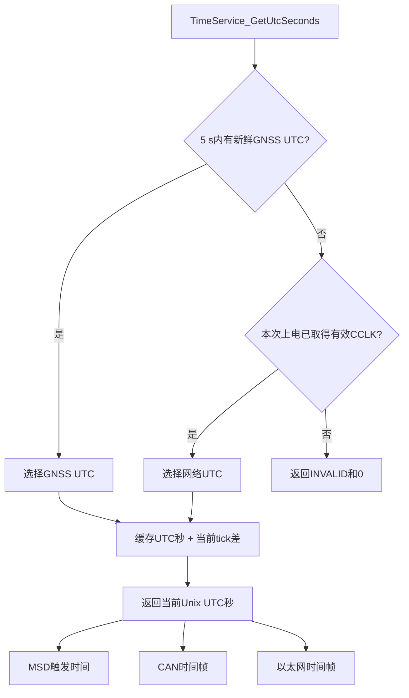
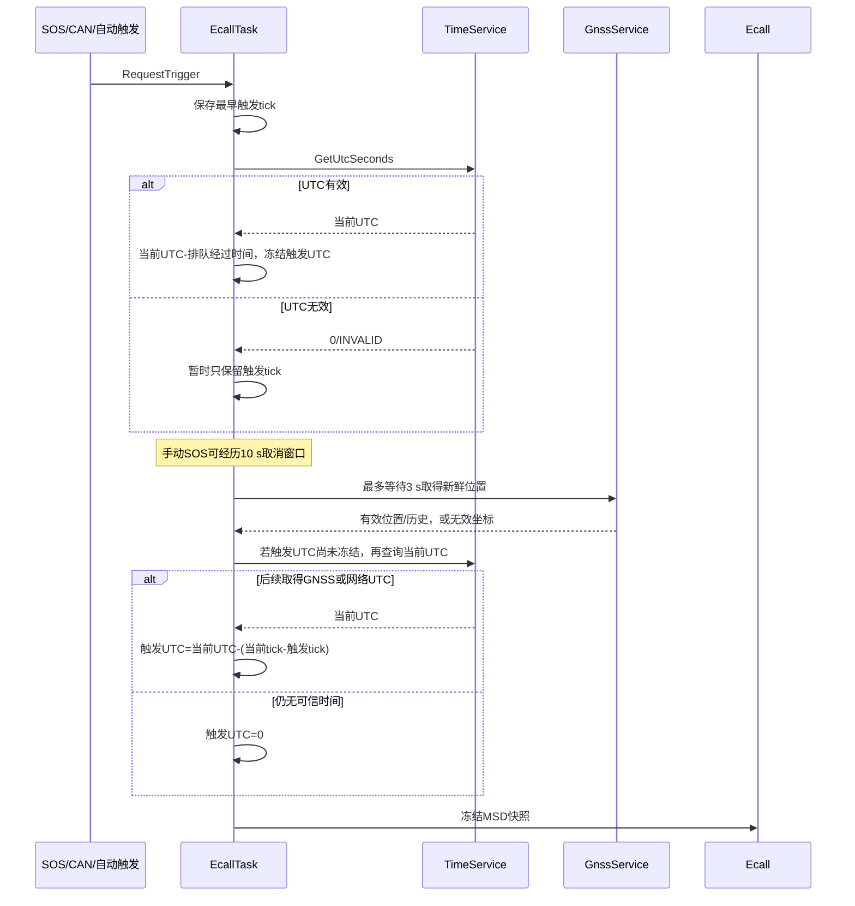

# AC7600 GNSS、UTC校时与MSD触发时间泳道图

## 当前策略

- MCU与AC7600共用UART4主AT通道，不把原始NMEA混入TCP和语音通道。
- `AT+CGPSINFO`正常查询周期为1 s；当前点新鲜度为5 s，只有新有效定位才推进 `T-1…T-9` 历史。
- UTC来源优先级为新鲜GNSS时间、网络NITZ/CCLK时间、无效值0。
- 上电配置一次 `AT+CTZU=1`；随后立即查询 `AT+CCLK?`。时间无效时最多进行6次10 s快速重试，成功或快速重试耗尽后每30 min校时。
- `+CCLK`时区以15 min为单位，例如重庆/北京时间 `+32` 表示UTC+8；存入MSD前统一换算为UTC秒。
- eCall记录触发源到达时的系统tick；触发时已有UTC就立即冻结，否则在构建MSD时用“当前UTC－已过去时间”回算。GNSS位置无效不再强制触发时间无效。

## 1. GNSS后台采集和9点历史

## 2. GNSS被紧急业务抢占

紧急抢占只中止当前后台GNSS事务，不把已经成功开启的GNSS误判为关闭，避免每次SOS后重新等待较长的GNSS上电过程。

## 3. NITZ/CCLK低频校时

网络UTC缓存保存“UTC秒＋采样tick”；两次校时之间用系统tick续算，不需要每10 s占用AT通道。模组复位或MCU重新初始化后会重新执行CTZU/CCLK流程。

## 4. UTC仲裁与对外输出

## 5. eCall触发时间冻结与后补

这保证MSD字段表示事件触发时刻，而不是取消窗口结束、GNSS等待结束、TCP连接或上传完成的时刻。同一事件重发继续使用第一次冻结的触发时间。

## 6. MSD位置与时间字段

| 标准区偏移 | 长度 | 内容 | 当前来源与无效值 |
|---:|---:|---|---|
| 23 | 4 | 触发时间 | Unix UTC秒，大端；无可信时间为0。 |
| 27 | 4 | 当前经度 | e7转换为度`×3,600,000`；无效为标准无效值。 |
| 31 | 4 | 当前纬度 | e7转换为度`×3,600,000`；无效为标准无效值。 |
| 35–106 | 72 | 9个历史点 | 每点先经度后纬度，顺序T-1至T-9。 |
| 107–110 | 4 | 事故字段 | 纵向Delta-V、横向Delta-V、乘员数、翻滚。 |

坐标换算采用整数四舍五入：`AECS raw = round(e7 × 9 / 25)`。位置是否有效与时间是否有效分别判断：没有新鲜坐标时，UTC仍可来自网络时间；没有网络时间时，新鲜GNSS UTC仍可用于触发时间。

## 7. 验证要求

1. 上电后确认CTZU只配置一次，首次CCLK立即查询；有效后日志中不再每10 s出现 `AT+CCLK?`。
2. 断开GNSS但保持蜂窝网络，触发MSD，确认触发时间来自CCLK且经纬度为无效值。
3. 触发时UTC无效，在10 s取消窗口或3 s GNSS等待期间取得时间，确认上传值回算到原触发时刻。
4. 同一事件发生15 s ACK超时并重传，确认 `ser`、MSD二进制和 `triggerTimeUtc` 均不改变。
5. 连续采集定位，核对当前点与T-1至T-9不重复、方向符号和坐标单位正确。
