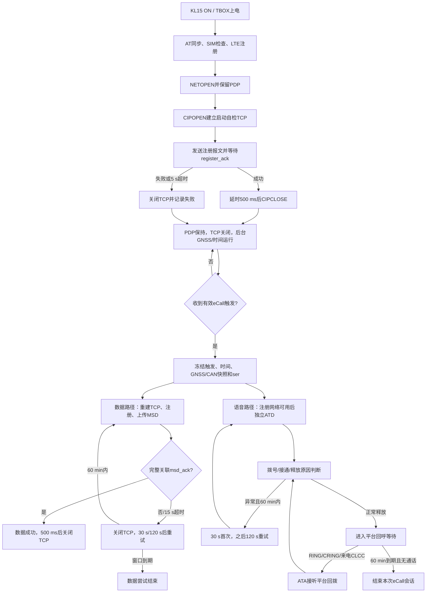
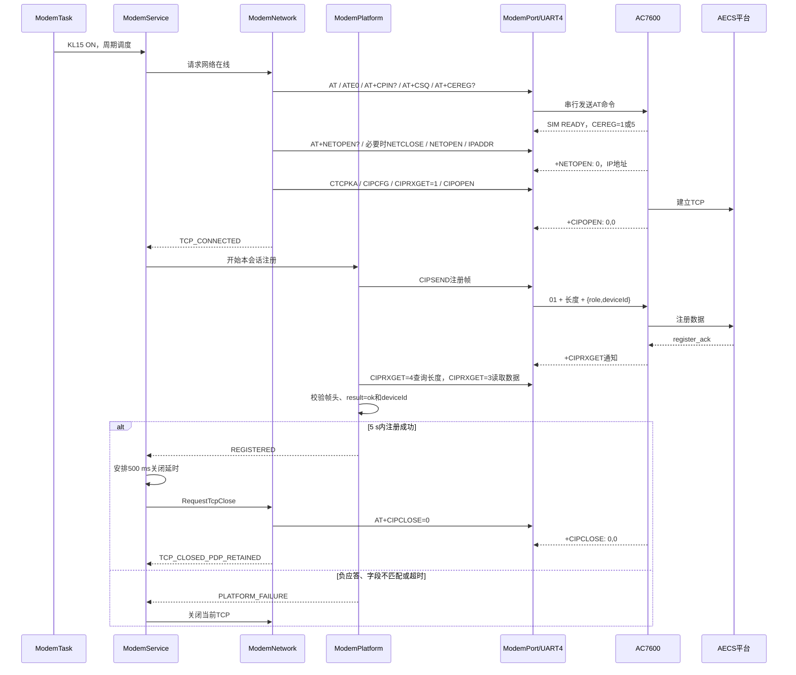
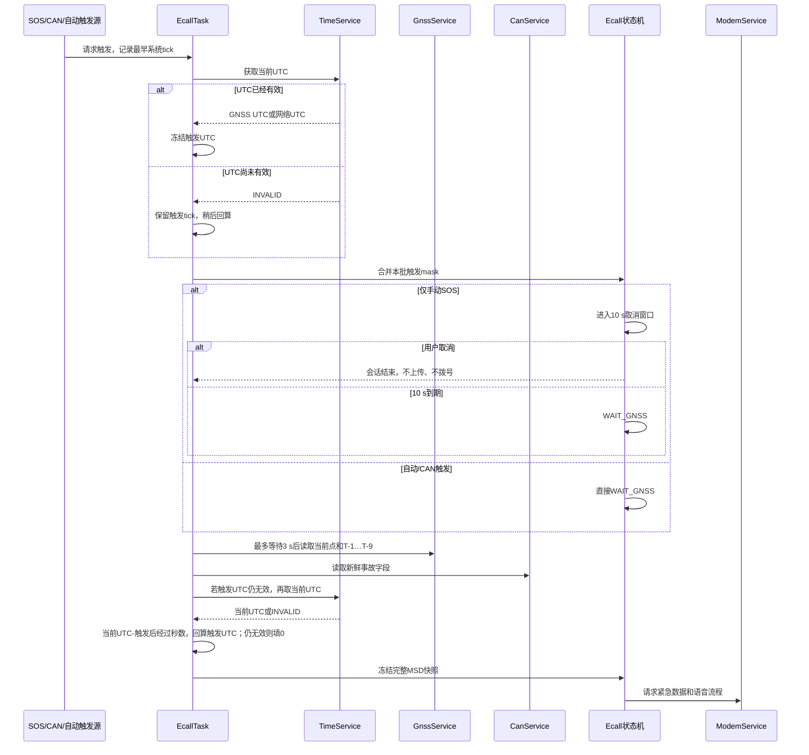
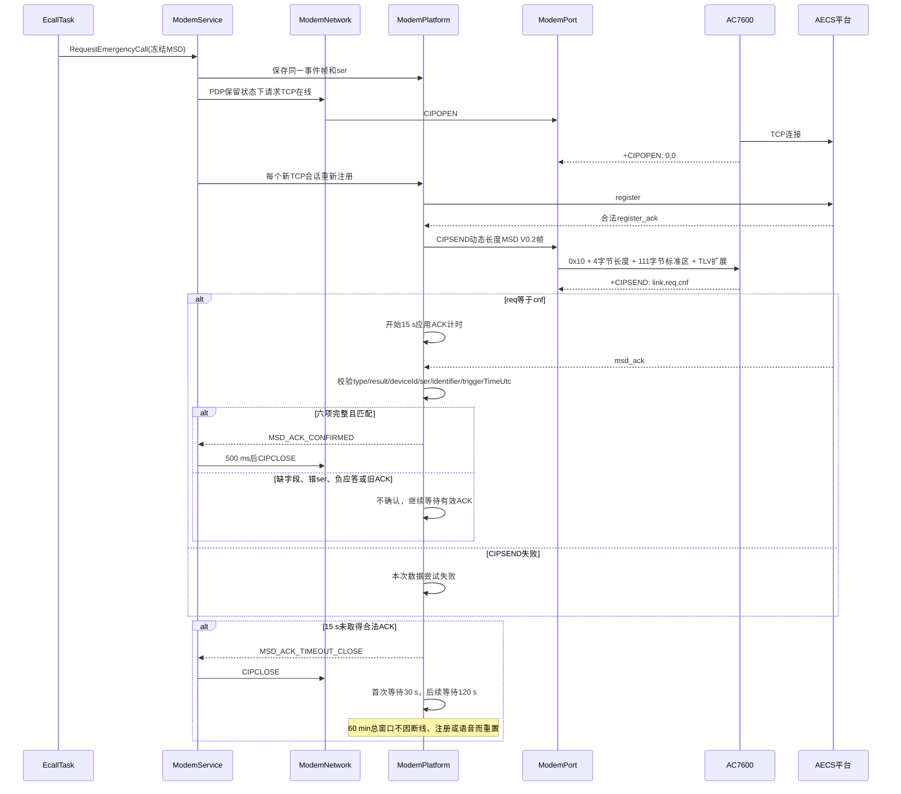
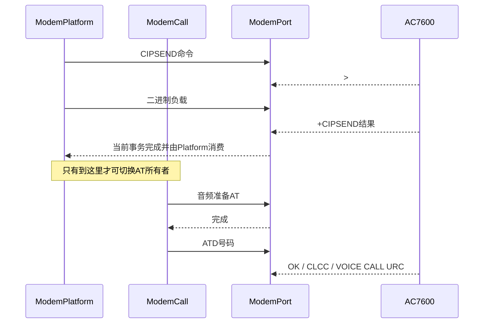
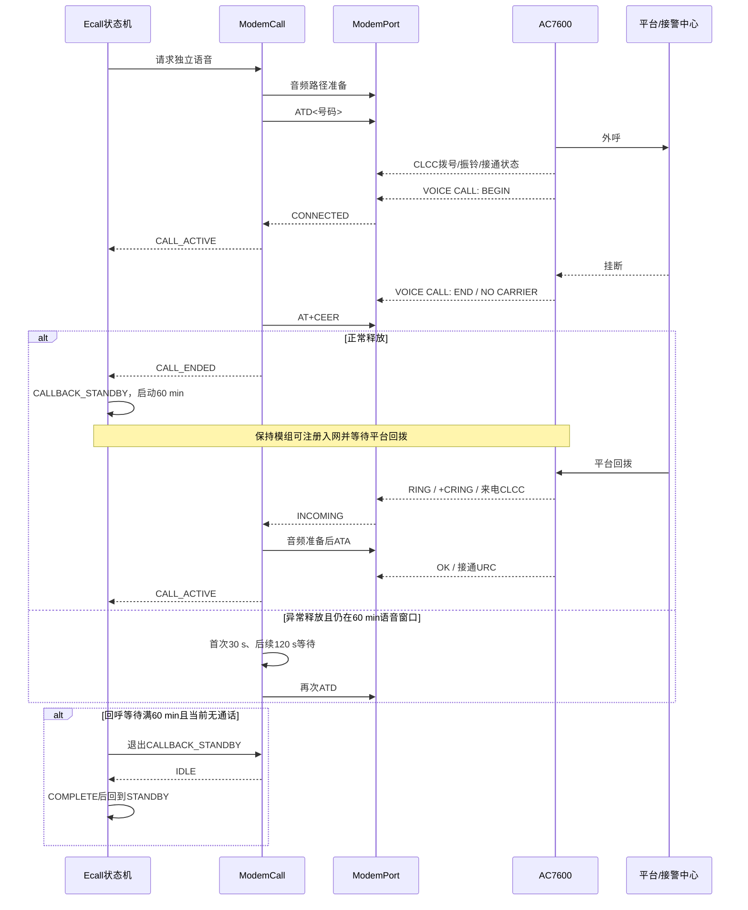
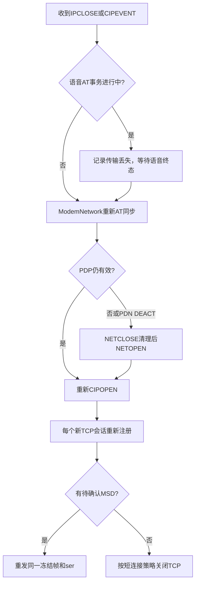

# AC7600 网络、MSD、语音与回呼流程泳道图

## 适用范围与证据边界

本文描述当前源码中的 AC7600 主路径，包括上电自检、PDP 保持、TCP 短连接、每会话注册、MSD 关联应答、数据/语音重试、通话结束后的平台回呼等待，以及异常链路恢复。

- 当前策略：保持 PDP，按业务建立 TCP；每个 TCP 会话都重新注册，业务结束后只执行 `AT+CIPCLOSE=0`，不执行 `AT+NETCLOSE`。
- 当前短连接模式不发送应用层 heartbeat；旧长连接的 `heartbeat_ack` 日志只作为历史实板证据。
- 数据成功以完整关联的 `msd_ack` 为准；`+CIPSEND` 仅表示数据已交给模组 TCP 栈。
- 语音不等待 `msd_ack`，但必须等待当前完整 AT 事务结束后才能使用同一 UART4。
- 当前代码已实现 60 min 数据/语音尝试窗口和通话后的 60 min 回呼等待；本轮改动尚未编译、烧写或实板验证。
- 原厂依据：`A76XX Series_TCPIP_Application Note_V1.05.pdf`、`A76XX_Series_AT_Command_Manual_V2.02.pdf`。

## 1. 总体业务流程

## 2. 上电自检、PDP与短连接注册

说明：`OK` 只代表命令已受理；`NETOPEN`、`CIPOPEN`、`CIPSEND` 和 `CIPCLOSE` 都必须分别等待对应异步结果。短连接关闭后 PDP 保留，下一次事件直接从 `CIPOPEN` 重建会话。

## 3. 手动/自动触发、取消窗口与快照

同一事件的重连和重发复用已冻结 MSD、`ser` 和触发时间，不用重发时刻覆盖原始触发时刻。

## 4. MSD短连接上传与关联应答

## 5. 数据与语音的AT口仲裁

语音业务不以 `msd_ack` 为门槛；如果数据事务正在 `>` 提示符、负载发送或结果等待阶段，语音只等待该事务结束，不会插入其中。TCP关闭不等于语音挂断，代码不因 `CIPCLOSE` 主动发送 `ATH`。

## 6. 外呼、释放原因与平台回拨

平台来电通过 `RING`、`+CRING:` 或 `+CLCC` 来电方向/状态识别。`ATA`失败且尚未接通时返回回呼等待，不把一次接听失败误转为主动外呼重试。

## 7. TCP/PDP异常恢复

## 8. 当前验证状态

| 流程 | 状态 | 说明 |
|---|---|---|
| UART、SIM、LTE、PDP、旧长连接注册/心跳/MSD | 有历史实板证据 | 不能替代当前短连接V0.2回归。 |
| PDP保持、TCP短连接、每会话注册 | 已实现并有软件验证 | 待实板验证 `CIPCLOSE` 后不执行 `NETCLOSE`。 |
| V0.2动态MSD、严格关联ACK、拆包/粘包 | 已实现并有软件验证 | 后台需按V0.2生成完整ACK。 |
| 数据/语音独立和30 s/120 s/60 min重试 | 已实现并有软件验证 | 待受控实板验证。 |
| 60 min回呼等待、来电识别和ATA | 已实现、未编译 | 待编译和平台真实回拨验证。 |
| UTC低频校时和MSD触发时间冻结 | 已实现、未编译 | 详见 `AC7600_GNSS_SWIMLANE.md`。 |
