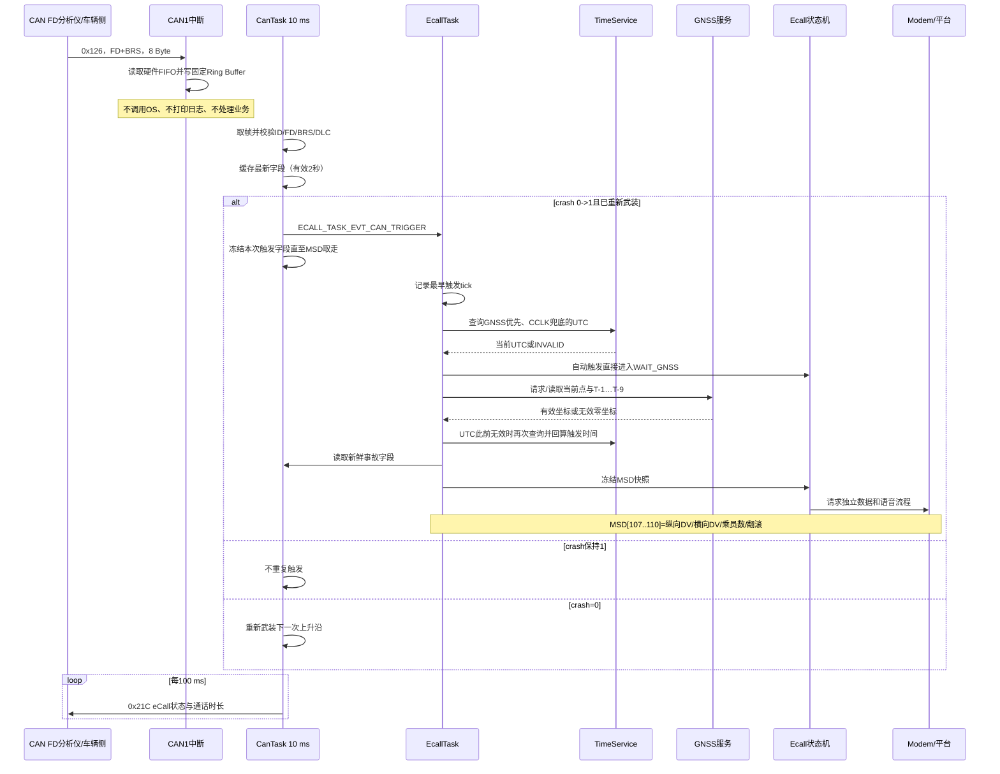

# CAN FD eCall 样机流程

## 接口边界

- 车辆侧 CAN1 接口当前由 HC32 CAN2 外设承载，PE2/TX、PE3/RX，标准 ID，名义段 500 kbit/s，数据段 2 Mbit/s；收发器使能/待机脚仍需按实板确认。
- 样机输入 `0x126`：CAN FD+BRS、DLC 8；Byte0 bit0 为碰撞，bit1 为翻滚，Byte1/2 为纵向/横向 Delta-V 原始值，Byte3 为乘员数。
- DBC 输出 `0x21C TBOX_EcallInfo`：CAN FD+BRS、DLC 8、周期 100 ms。
- `0x126` 不是所提供 DBC 的正式报文，只是当前样机测试契约；IMU、NM、CanTp 和 UDS 均不接入。

## 泳道图

CAN触发属于自动触发，不进入10 s手动取消窗口。MSD触发时间取 `0x126` 上升沿进入任务系统时的时间；后续等待GNSS、TCP重连和数据重试都不改变该值。

## 实板验证顺序

1. 先只观察 `0x21C` 是否每 100 ms 发出，确认标准 ID、FD、BRS、DLC 8 和 500K/2M。
2. 发送 `0x126: 00 00 00 FF 00 00 00 00` 只完成触发重新武装，不会启动 eCall。
3. 只有在平台、号码和真实外呼时机均已获明确授权，或已切换到不会真实拨号的测试环境后，才发送 `0x126: 01 12 08 02 00 00 00 00`；预期只触发一次 eCall。
4. 核对上传 MSD 的 111 字节负载中 Byte107–110 为 `12 08 02 00`。
5. 连续保持 crash=1 不应重复触发；先发 crash=0 后再次置 1 才允许下一次触发。

> 收发器 EN/STB、终端电阻和分析仪接线必须按原理图确认；当前代码没有为未知硬件脚位添加 GPIO 控制。
